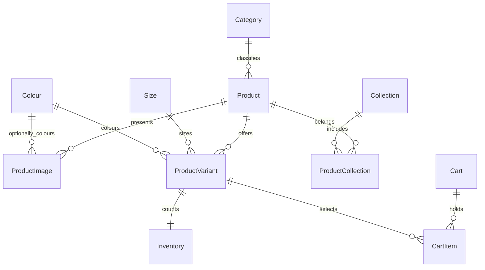

# Architecture

SvelteKit renders catalogue pages and owns the UI. Browser requests use its /api proxy; ASP.NET Core exclusively owns catalogue, inventory, cart, and checkout rules. PostgreSQL is the source of truth. The proxy forwards only required request headers and preserves multiple Set-Cookie headers.

In production, the proxy uses a shared secret to reach API routes. The API accepts the HTTPS scheme assertion only after verifying that secret. Health checks are public. Do not expose or log the secret. Production cookies are Secure, HttpOnly, and SameSite=Lax; all unsafe API methods require an antiforgery token. Identity role checks protect admin routes.

## Data relationships

A variant has a unique SKU and unique product/size/colour combination. Inventory quantity cannot be negative; its version is an optimistic concurrency token. Cart items are unique per cart/variant and hold a previously acknowledged price for change detection. Product prices are integer paise.

## Cart operations
The guest cookie contains a protected identifier, not a caller-chosen cart ID. Writers lock the cart row with PostgreSQL FOR UPDATE inside a transaction; repeated additions merge. Reads recalculate from current product prices and surface publication, stock, and price changes. Checkout is blocked until changes are resolved. Bags do not reserve stock.

## Checkout
Guest contact, Indian address/PIN, billing details, packaging, and message length are validated. Addresses are not stored. Preview neither creates an order nor decrements inventory.

## Operation defaults
One API replica. Seed and migrations run at startup when explicitly enabled; repeat launches retain admin product changes. Persistent PostgreSQL storage and data-protection keys are necessary to preserve carts and authentication across redeploys. For multiple replicas, move migrations/seeding to a deployment job and share the key store.

Login rate limiting is deliberately conservative: through the proxy, limits are shared per API peer. Full production work should establish trusted client-IP forwarding before changing this policy.

## API
Live local contract: http://localhost:5080/openapi/v1.json.
Generated TypeScript definitions: frontend/src/lib/generated/api.d.ts.
Run the API, install tools dependencies, and run npm --prefix frontend run generate:api after API contract changes. The API enforces strict JSON numeric values and exports matching numeric TypeScript fields; prices are integer paise.

